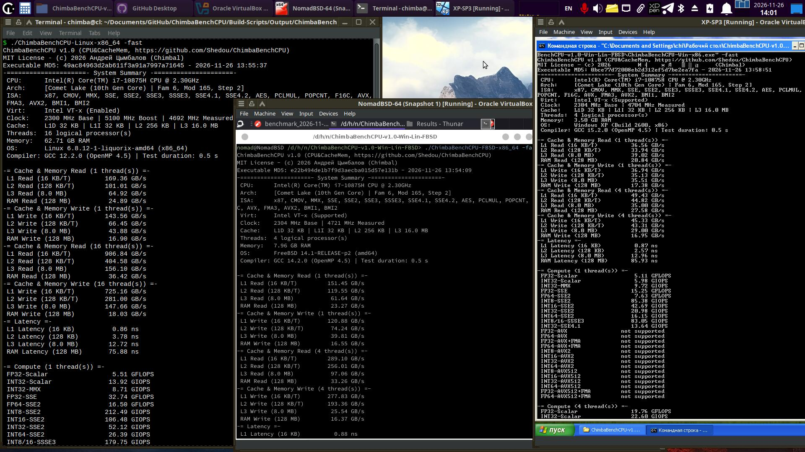

# ChimbaBenchCPU  | [ChimbaBenchCL](https://github.com/Shedou/ChimbaBenchCL)

ChimbaBenchCPU — это легковесный кроссплатформенный бенчмарк с открытым исходным кодом, предназначенный для измерения производительности центральных процессоров (CPU). Проект был создан с помощью искусственного интеллекта (не является полностью сгенерированным ИИ). Использование ИИ помогло значительно ускорить процесс разработки и повысить качество проекта.

  
English translation

ChimbaBenchCPU is a lightweight, open-source, cross-platform benchmark designed to measure the performance of central processing units (CPUs). The project was created using artificial intelligence (is not entirely AI-generated). The use of AI helped significantly speed up the development process and improve the quality of the project.

## Usage / Использование

Распаковать актуальный официальный архив с программой и запустить подходящую версию исполняемого файла для Linux, Windows или FreeBSD. Результаты тестирования будут сохраняться в файл внутри каталога `Results`, рядом с исполняемым файлом.

Дополнительные параметры запуска можно узнать запустив программу с аргументом `-help` или `--help`. Параметры могут меняться в зависимости от версии бенчмарка.

  
English translation

Unpack the latest official archive containing the program and run the appropriate version of the executable file for Linux, Windows, or FreeBSD. Test results will be saved to a file within the `Results` directory, located next to the executable file.

Additional launch parameters can be found by running the program with the `-help` or `--help` argument. The available parameters may vary depending on the version of the benchmark.

## System requirements:
- CPU: x86 / x86_64
- RAM: 256 MB+
- OS: 64-bit (x86_64) - Windows 7+, Linux 2.6.32+, FreeBSD
- OS: 32-bit (x86) - Windows XP+, Linux 2.6.32+, FreeBSD

## Test Suite / Набор тестов (v1.0):
- Cache & Memory:
- - L1, L2, L3 Read / Write
- - L1, L2, L3 Latency
- - RAM Read / Write
- - RAM Latency
- Compute:
- - FP32 - Scalar, SSE, AVX, AVX+FMA, AVX512+FMA
- - FP64 - SSE2, AVX, AVX+FMA, AVX512+FMA
- - INT8 - SSE2, AVX2, AVX512
- - INT8/16 - SSSE3
- - INT16 - SSE2, AVX2, AVX512
- - INT32 - Scalar, MMX, SSE2, SSE4.1, AVX2, AVX512
- - INT64 - SSE2, AVX2, AVX512

## Screenshoot

## Примечание:
Стандартный запуск теста обычно занимает до 2-3 минут, в зависимости от процессора и его возможностей. Чтобы выполнить тест быстрее - за счет более низкой точности результата (занимает примерно 35-40 секунд) - вы можете использовать аргумент «-fast» или «--fast».

  
English translation

  
Note:\
A standard benchmark run typically takes up to 2-3 minutes, depending on the processor and its capabilities. To perform a quicker test-at the cost of lower result precision (taking approximately 35-40 seconds)-you can use the `-fast` or `--fast` argument.

## Компиляция из исходного кода

Разработка проводилась в дистрибутиве Chimbalix (Debian 12) с компилятором GCC 12.2 (OpenMP 4.5). Более старые дистрибутивы не проверялись и не отлаживались в плане компиляции проекта.

Основной целевой компилятор - это GCC. Код иногда дорабатывается для совместимости с компилятором Clang, но этот компилятор не основной, так как не позволяет скомпилировать проект статически без зависимостей.

Для компиляции под Windows использовался [w64devkit v2.5.0](https://github.com/Shedou/ChimbaBenchCL/releases/tag/ChimbaBenchCL-Build-Tools-11).

1) Использовать скрипты в каталоге Build-Scripts (Windows/Linux/FreeBSD). Убедитесь, что есть все необходимые для компиляции инструменты (w64devkit для Windows в каталоге Build-Tools).

2) Запустить `make` в каталоге с файлом `Makefile`, получившийся файл будет непригоден для распространения (ад зависимостей).

3) Изучить исходный код и вручную ввести команду для компиляции.

  
English translation

  
Development was carried out using the Chimbalix distribution (Debian 12) with the GCC 12.2 compiler (OpenMP 4.5). Older distributions have not been tested or debugged for project compilation.

The primary target compiler is GCC. The code is occasionally adjusted for compatibility with the Clang compiler; however, Clang is not the primary choice, as it does not allow for a static build of the project without external dependencies.

For compilation on Windows, [w64devkit v2.5.0](https://github.com/Shedou/ChimbaBenchCL/releases/tag/ChimbaBenchCL-Build-Tools-11) was used.

1) Use the scripts located in the `Build-Scripts` directory (for Windows, Linux, or FreeBSD). Ensure that all necessary compilation tools are available (e.g., `w64devkit` for Windows, located in the `Build-Tools` directory).

2) Run `make` in the directory containing the `Makefile`; the resulting file will be unsuitable for distribution (due to dependency hell).

3) Examine the source code and manually execute the appropriate compilation command.

